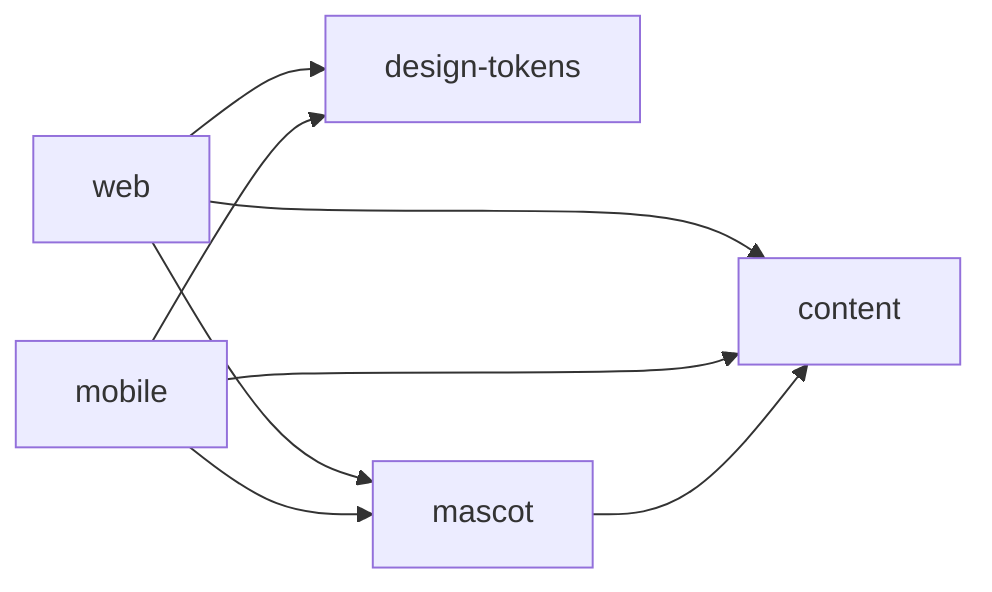

# QuantX UI 工程说明

本仓库通过 npm workspaces 和 Nx 管理 Astro Web、Expo / React Native Mobile，以及三个平台无关的共享库。本文说明工程入口、文件职责、依赖边界和维护方式；历史验收记录位于 `review/`。

## 1. 安装、运行与构建

所有命令都在仓库根目录执行，项目使用一个 `package-lock.json`。

```powershell
cd E:\bigshoot\qntx.ui
npm ci
```

`npm ci` 按锁文件重新安装依赖，适用于首次克隆、CI 和严格复现。依赖已安装且锁文件未变化时，可以直接启动；增加或更新依赖时使用 npm 更新清单与锁文件。

| 命令                              | 实际入口与用途                                                                     |
| --------------------------------- | ---------------------------------------------------------------------------------- |
| `npm run dev` / `npm run dev:web` | Nx `web:dev` → Astro 开发服务，默认 `http://127.0.0.1:4321/`。                     |
| `npm run dev:mobile`              | 直接启动 Mobile 工作区的 `expo start`，用于 Expo Go / 原生客户端连接。             |
| `npm run dev:mobile:web`          | Nx `mobile:preview` → Expo Web，地址 `http://localhost:8082/`。                    |
| `npm run build`                   | Nx `web:build` → Astro 静态构建，输出 `apps/web/dist/`。                           |
| `npm run preview`                 | 预览 Web 构建产物，需先执行 `npm run build`。                                      |
| `npm run build:mobile`            | Nx `mobile:export` → 导出 Android / iOS Hermes 与 Web 资源到 `apps/mobile/dist/`。 |

三个开发入口分别在独立终端运行。Astro 网站与 Expo Web 是两个应用，使用不同的运行时和组件树；Expo Web 用于辅助验证 Mobile 代码，不能替代原生真机测试。

### Mobile 调试条件

- 手机须能访问电脑的 Metro 服务，通常连接同一局域网；Expo Go 需支持项目锁定的 SDK。
- `dev:mobile` 有意直接进入 Expo，保留交互式终端的二维码和快捷键。Nx 的 Windows `stream` 转发可能让 Expo 判定为非交互式终端；构建、检查和边界任务仍由 Nx 管理。
- 本地 Android 原生编译需要 Android SDK / ADB；本地 iOS 原生编译与模拟器需要 macOS / Xcode。
- `build:mobile` 生成 JS / Hermes 资源，不生成 APK、AAB 或 IPA。原生安装包、签名与发布需要另行配置。

```powershell
# 自定义 Metro 端口
npm run dev:mobile -- --port 8091

# 停止旧服务后清理 Metro 缓存，适用于切换工程结构后的解析异常
npm run dev:mobile -- --clear

# 使用生产模式 JS 比较性能；仍不同于 release 原生安装包
npm run dev:mobile -- --no-dev --minify
```

### 锁定的主要版本

| 范围            | 版本                                                                                              |
| --------------- | ------------------------------------------------------------------------------------------------- |
| 项目 Node / npm | `node` 包 `24.22.0`；`packageManager` 声明 `npm@10.9.2`。                                         |
| 工作区工具      | Nx `24.0.0`，TypeScript `6.0.3`。                                                                 |
| Web             | Astro `7.4.0`，`@astrojs/react` `7.1.0`，Tailwind `4.3.3`。                                       |
| 两端 React      | React / React DOM `19.3.0`；根 `overrides` 保持版本一致。                                         |
| Mobile          | Expo `58.0.17`，React Native `0.88.0`，React Native Web `~0.21.4`，`react-native-svg` `15.16.0`。 |

准确安装结果以根锁文件为准；版本提示不等于运行错误，不应因单条提示混装不同 SDK 的依赖。

## 2. 根目录文件

应用代码位于 `apps/`，共享源码位于 `packages/`。根目录承担依赖安装、任务入口和统一规则。

下面按目录逐个说明文件。职责表先用白话概括用途，再保留技术细节；单独展开的文件也按同样顺序介绍。

| 文件                                             | 职责                                                                                                                                                                    |
| ------------------------------------------------ | ----------------------------------------------------------------------------------------------------------------------------------------------------------------------- |
| [package.json](package.json)                     | 整个仓库的依赖清单和命令入口，决定安装什么、如何启动与检查各项目。 声明 `apps/*` / `packages/*` 工作区、根命令、公共开发依赖、React 版本覆盖和包管理器版本。            |
| [package-lock.json](package-lock.json)           | 记录实际安装的依赖版本，让其他电脑和构建服务器尽量装出同一套环境。 锁定第三方版本及本地 workspace 链接；两个应用不单独维护锁文件。                                      |
| [nx.json](nx.json)                               | 告诉 Nx 哪些任务需要重跑、哪些结果可以复用，以及任务之间怎样配合。 设置 `main` 比较基线、任务输入、公共配置依赖及构建 / 导出 / 检查缓存；当前关闭 daemon 和交互式 TUI。 |
| [eslint.config.mjs](eslint.config.mjs)           | 检查代码有没有越界引用，例如网页误用手机端代码、共享库反过来依赖应用。 加载 Nx 依赖边界规则；为 `.astro` 配置专用解析器；限制共享库使用浏览器全局和框架依赖。           |
| [oxlint.config.ts](oxlint.config.ts)             | 指定代码质量检查规则，发现常见写法问题和潜在错误。 导入 qntx React 预设并合并忽略范围、CSS / Metro 初始化导入规则。                                                     |
| [oxfmt.config.ts](oxfmt.config.ts)               | 指定大多数项目文件如何自动排版，以及哪些文件应跳过。 导入 qntx 格式预设，排除 `.astro`、锁文件、缓存、测试输出及原生产物。                                              |
| [.prettierrc.json](.prettierrc.json)             | 专门配置 Astro 模板的自动排版。 加载 `prettier-plugin-astro`，负责 `.astro` 模板格式化。                                                                                |
| [tsconfig.base.json](tsconfig.base.json)         | 为整个仓库提供共同的 TypeScript 检查基础。 继承 qntx `strictest`，提供公共目标、模块解析、JSON 导入等设置，供各项目补充环境。                                           |
| [tsconfig.json](tsconfig.json)                   | 检查根目录的配置和工具代码，不负责把所有应用放进同一种环境。 检查根目录配置与纳入范围的工具脚本；不作为 Web / Mobile 的统一运行环境。                                   |
| [wrangler.jsonc](wrangler.jsonc)                 | 告诉 Cloudflare 要部署哪个站点，以及到哪里读取已构建的网页文件。 声明 Cloudflare Worker 名称、兼容日期和 `./apps/web/dist` 静态资源目录。                               |
| [.npmrc](.npmrc)                                 | 控制 npm 从哪里下载包，以及下载失败时的重试方式等。 项目 npm 源、重试和审计输出设置。                                                                                   |
| [.gitignore](.gitignore)                         | 告诉 Git 哪些本地文件不要跟踪和上传。 排除依赖、缓存、构建结果、测试输出、环境变量和本地备份等生成资料。                                                                |
| [qntx-ui.code-workspace](qntx-ui.code-workspace) | 让 VS Code 把这个目录作为一个工作区打开。 以当前目录打开 VS Code 工作区。                                                                                               |
| [README.md](README.md)                           | 说明项目怎么运行、每个文件管什么，以及维护时应遵守的约定。 当前工程的统一维护说明。                                                                                     |

### `.vscode/`

| 文件                                               | 职责                                                                                                                                                                              |
| -------------------------------------------------- | --------------------------------------------------------------------------------------------------------------------------------------------------------------------------------- |
| [.vscode/settings.json](.vscode/settings.json)     | 让 VS Code 在这个项目中使用正确的检查工具、TypeScript 和格式化方式。 保存时格式化、Oxc 使用的项目 Node、TypeScript SDK 与 Tailwind 入口；项目迁移路径后需要核对 `oxc.path.node`。 |
| [.vscode/extensions.json](.vscode/extensions.json) | 向打开项目的人推荐需要的 VS Code 扩展。 推荐编辑器扩展，不参与生产构建。                                                                                                          |

`oxc.path.node` 解决 Oxc 加载 `.ts` 配置的运行时问题；`js/ts.tsdk.path` 选择编辑器的 TypeScript 语言服务，两者用途不同。项目内 Node 不会直接替换系统 Node。

## 3. `apps/web/`

### 3.1 配置文件

| 文件                                                           | 职责                                                                                                                                                  |
| -------------------------------------------------------------- | ----------------------------------------------------------------------------------------------------------------------------------------------------- |
| [apps/web/package.json](apps/web/package.json)                 | 单独列出网站需要的依赖和网站自己的运行命令。 声明 Astro / React / Tailwind 与共享库依赖，提供该应用的 `dev`、`build`、`preview`、`check` 命令。       |
| [apps/web/project.json](apps/web/project.json)                 | 把网站登记给 Nx，让根目录命令能找到并执行网站的任务。 注册 Nx `web` 项目、标签、构建输出及开发 / 检查 / 测试目标；通过 `nx:run-commands` 调用 Astro。 |
| [apps/web/astro.config.mjs](apps/web/astro.config.mjs)         | 配置 Astro 如何使用 React 和 Tailwind，以及如何生成网站。 接入 React 集成和 Tailwind Vite 插件，设置站点地址，沿用 Astro 静态输出。                   |
| [apps/web/tsconfig.json](apps/web/tsconfig.json)               | 让 TypeScript 按 Astro 网页环境检查这部分代码。 在公共配置后继承 Astro 严格配置，补齐 React JSX、Astro / Node 类型及生成文件范围。                    |
| [apps/web/playwright.config.ts](apps/web/playwright.config.ts) | 规定网页自动测试用哪个浏览器、怎样启动网站，以及失败后留下什么证据。 Web 浏览器测试目录、Chrome 通道、视口、4321 服务与失败时截图 / trace。           |

### 3.2 `src/pages/`

Astro 根据此目录中的文件生成 URL。当前仅保留首页路由，由同一个开发服务提供。

| 文件                                                             | 职责                                                                                                                                                            |
| ---------------------------------------------------------------- | --------------------------------------------------------------------------------------------------------------------------------------------------------------- |
| [apps/web/src/pages/index.astro](apps/web/src/pages/index.astro) | 网站首页的总入口，把两套网页结构、样式和切换脚本接起来。 `/` 路由：导入两套 Web 组件结构和全局样式，将共享颜色映射为 CSS 变量，挂载响应式控制器并注册销毁回调。 |

页面中的 React 组件由 Astro 在构建时输出 HTML / SVG；当前没有通过 `client:*` 指令进行 React 客户端水合。浏览器交互由下面的 TypeScript 控制器接管。

这里的 `client:*` 是 Astro 客户端指令的统称，例如 `client:load` 表示页面加载时启动组件的客户端代码；水合就是让浏览器中的 React 接管已生成的 HTML，接上 React 的事件和状态更新。本项目不使用这条路径，而是由独立脚本操作页面元素。

### 3.3 `src/components/`

| 文件                                                                                   | 职责                                                                                                                                                                                                        |
| -------------------------------------------------------------------------------------- | ----------------------------------------------------------------------------------------------------------------------------------------------------------------------------------------------------------- |
| [apps/web/src/components/NarrativeHome.tsx](apps/web/src/components/NarrativeHome.tsx) | 搭出桌面网页的 HTML / SVG 结构，具体滚动和动画交给脚本控制。 桌面结构入口；输出控制器需要的轨道、场景、SVG 路径及测量槽位，通过 `data-*` 与脚本解耦。                                                       |
| [apps/web/src/components/MobileWebSite.tsx](apps/web/src/components/MobileWebSite.tsx) | 搭出手机浏览器及电脑窄窗口使用的网页结构，不使用 React Native。 窄屏 Web 结构入口；组合原有面板组件、导航与无障碍播报节点，不是 React Native 入口。根据视口宽度启用对应布局，真实手机浏览器也使用这套网页。 |
| [apps/web/src/components/SiteHeader.tsx](apps/web/src/components/SiteHeader.tsx)       | 生成窄屏网页的顶部导航，实际切屏行为交给导航脚本。 窄屏网页的导航结构；读取共享链接和 section 数据，输出导航控制器识别的标记。                                                                              |
| [apps/web/src/components/SiteFooter.tsx](apps/web/src/components/SiteFooter.tsx)       | 生成窄屏网页的底部进度、前后按钮和返回入口。 窄屏网页的位置、前后导航及返回入口；只输出结构，由控制器同步状态。                                                                                             |
| [apps/web/src/components/HomeIntro.tsx](apps/web/src/components/HomeIntro.tsx)         | 把共享介绍数据排成窄屏网页的 Overview 区块。 将共享 `hero`、`standards` 与链接转换为窄屏页面的静态 React 标记。                                                                                             |
| [apps/web/src/components/ProtocolPanel.tsx](apps/web/src/components/ProtocolPanel.tsx) | 把共享协议数据排成窄屏网页的 Protocols 区块，并生成链接。 将共享 `primitives` 转换为窄屏网页的列表与外链，维护稳定的列表标识。                                                                              |
| [apps/web/src/components/AboutPanel.tsx](apps/web/src/components/AboutPanel.tsx)       | 把共享组织资料和链接排成窄屏网页的 About 区块。 将共享 `aboutIntro` / `aboutDestinations` 组合为窄屏网页片段。                                                                                              |
| [apps/web/src/components/BrandMark.tsx](apps/web/src/components/BrandMark.tsx)         | 在窄屏网页需要的位置画出静态 Q Logo。 React HTML SVG 包装；读取共享静态路径，供窄屏网页组件复用。                                                                                                           |
| [apps/web/src/components/Icon.tsx](apps/web/src/components/Icon.tsx)                   | 让桌面和窄屏网页用同一套箭头、GitHub 等小图标。 Web SVG 图标集合，统一箭头与 GitHub 图标的结构、尺寸入口和无障碍处理。                                                                                      |

`data-*` 是 HTML 的自定义属性，后缀由项目约定，例如 `data-narrative`、`data-panel`；脚本用这些标记找到需要控制的元素，属性本身不会自动产生交互。窄屏网页按浏览器视口宽度启用，电脑窗口缩窄或页面放大也可能进入它；`npm run dev:mobile:web` 启动的则是另一个应用的 Expo Web 预览。

### 3.4 `src/data/` 与环境声明

| 文件                                                   | 职责                                                                                                                                                           |
| ------------------------------------------------------ | -------------------------------------------------------------------------------------------------------------------------------------------------------------- |
| [apps/web/src/data/site.ts](apps/web/src/data/site.ts) | 保留旧组件取数据的入口，实际数据统一从共享库读取。 从 `@qntx-ui/content` 转出 `links`、`primitives`、`sections`，兼容原 Web 组件的导入路径，不再维护重复数据。 |
| [apps/web/src/env.d.ts](apps/web/src/env.d.ts)         | 让编辑器和类型检查认识 Astro 提供的环境类型。 声明 Astro 客户端类型环境。                                                                                      |

### 3.5 `src/scripts/`

#### `responsive-home.ts`

负责桌面与窄屏网页的交互切换。窗口缩放或浏览器缩放跨过宽度边界时，先停掉旧控制器，再启动对应的新控制器；两套结构的显示隐藏由 CSS 配合完成。

[源码](apps/web/src/scripts/responsive-home.ts)。入口为 `initializeResponsiveHome(): () => void`，由首页调用。它以 `761px` 为桌面边界，动态导入 `scroll-narrative` 或 `mobile-web-navigation`，同一时刻只挂载一个首页控制器。

切换断点前先执行旧控制器的清理函数；异步导入使用递增 `revision` 和 `stopped` 标记，防止迟到的导入重新挂载旧控制器。返回函数移除媒体查询监听并销毁当前实例。

#### `scroll-narrative.ts`

把桌面网页的滚动距离换算成元素的位置、透明度和当前阶段，是桌面滚动交互的控制中心。

[源码](apps/web/src/scripts/scroll-narrative.ts)。入口为 `initializeScrollNarrative(root): () => void`。它读取轨道、SVG 容器、目标槽位和场景节点；将原生文档滚动换算为归一化进度，并通过连续插值更新 DOM 样式。

目标位置来自 `getBoundingClientRect()`，而不是固定百分比。滚动事件通过单个 `requestAnimationFrame` 合并；`ResizeObserver` 负责重新测量。活动场景同时更新 `inert`、`aria-hidden` 和指针状态，避免不可见区域接收操作。该控制器不拦截桌面 wheel / touch 输入。

销毁时中止事件监听、断开 observer、取消帧任务、销毁动画控制器，并移除增强产生的属性与内联样式。

#### `mobile-web-navigation.ts`

让窄屏网页的滚轮、键盘、导航链接和前后按钮控制同一套横向面板，并让地址、进度和按钮状态跟着变化。

[源码](apps/web/src/scripts/mobile-web-navigation.ts)。入口为 `initializeMobileWebNavigation(): () => void`，仅在窄屏 Web 分支加载。它将滚轮、方向键、Home / End、锚点及前后按钮映射到同一组 Scroll Snap 节点，按 `scrollLeft / clientWidth` 计算活动索引。

它负责 URL hash、导航 `aria-current`、按钮禁用状态和播报节点的同步；对输入框保留键盘行为。面板确有纵向溢出时优先允许内部阅读，再处理横向导航。事件集中使用 `AbortController`，尺寸监听和 RAF 在销毁时一起清理。

#### `mascot-animation.ts`

控制网页 SVG 什么时候播放、暂停或切换形状，并把每一帧计算结果画到已有的 SVG 上。

[源码](apps/web/src/scripts/mascot-animation.ts)。包含两个接口：`createMascotPainter()` 将共享几何写入三个 SVG path；`initializeMascotAnimation()` 管理 Web 的播放状态、输入计时、过渡与生命周期。

控制器接收 `setPhase()`，使用共享引擎和轮廓插值生成帧，通过 SVG 属性更新绘制，不依赖 React 重渲染。文档可见性与媒体偏好决定暂停条件；`dispose()` 负责取消 RAF、计时器及事件监听并复位绘制。此文件拥有浏览器 API，不能放入共享库。

### 3.6 `src/styles/`

| 文件                                                                     | 职责                                                                                                                                                            |
| ------------------------------------------------------------------------ | --------------------------------------------------------------------------------------------------------------------------------------------------------------- |
| [apps/web/src/styles/global.css](apps/web/src/styles/global.css)         | 设置整个网站共用的基础样式，并在窄屏时启用对应样式文件。 Tailwind 入口、基础元素规则、字体和全局变量；以媒体条件导入窄屏 CSS。                                  |
| [apps/web/src/styles/narrative.css](apps/web/src/styles/narrative.css)   | 规定桌面网页的排版，并配合脚本控制定位、过渡和两套结构的显示。 桌面结构的定位和响应式规则；区分默认文档布局与脚本增强后的 sticky 布局，处理减少动态效果等分支。 |
| [apps/web/src/styles/mobile-web.css](apps/web/src/styles/mobile-web.css) | 规定窄屏网页怎么排版、横向停靠和适应不同屏幕高度。 窄屏 Web 的完整样式集合，包含导航、Scroll Snap、组件布局和高度适配；由 `global.css` 限定导入范围。           |

### 3.7 `public/`

| 文件                                                       | 职责                                                                |
| ---------------------------------------------------------- | ------------------------------------------------------------------- |
| [apps/web/public/favicon.svg](apps/web/public/favicon.svg) | 浏览器标签页上使用的网站小图标。 以 `/favicon.svg` 提供的站点图标。 |

### 3.8 `tests/`

| 文件                                                                   | 职责                                                                                                                                |
| ---------------------------------------------------------------------- | ----------------------------------------------------------------------------------------------------------------------------------- |
| [apps/web/tests/narrative.spec.ts](apps/web/tests/narrative.spec.ts)   | 自动操作桌面网页，检查滚动、动画定位和响应式切换有没有出问题。 桌面滚动控制、轮廓插值、定位测量、响应式重挂载、无脚本与无障碍分支。 |
| [apps/web/tests/narrow-web.spec.ts](apps/web/tests/narrow-web.spec.ts) | 自动缩窄浏览器，检查窄屏网页的导航和面板切换是否正常。 窄屏控制器、节点数量、导航与既有行为的保留。                                 |

## 4. `apps/mobile/`

### 4.1 配置与注册入口

| 文件                                                                 | 职责                                                                                                                                                       |
| -------------------------------------------------------------------- | ---------------------------------------------------------------------------------------------------------------------------------------------------------- |
| [apps/mobile/package.json](apps/mobile/package.json)                 | 单独列出手机应用需要的依赖、运行命令和启动入口。 声明 Expo、React Native、React Native Web、SVG、安全区域及共享库依赖；`main` 指向 `index.ts`。            |
| [apps/mobile/project.json](apps/mobile/project.json)                 | 把手机应用登记给 Nx，让根目录能统一调用它的检查、导出和测试任务。 注册 Nx `mobile` 项目，定义启动、辅助预览、导出、类型检查、边界、doctor 与两类测试目标。 |
| [apps/mobile/app.json](apps/mobile/app.json)                         | 设置 Expo 应用的名字、平台身份、屏幕方向等基本信息。 Expo 应用名、slug、scheme、平台标识、方向和 Web 输出配置；当前原生应用标识为 `org.qntx.mobile`。      |
| [apps/mobile/metro.config.mjs](apps/mobile/metro.config.mjs)         | 配置手机应用打包器如何读取源码，并限制并行处理数量。 使用 Expo 默认工作区解析，只额外设置 `maxWorkers = 2`；没有手写 React 别名或跨目录复制方案。          |
| [apps/mobile/tsconfig.json](apps/mobile/tsconfig.json)               | 让 TypeScript 按 Expo / React Native 环境检查手机应用代码。 叠加公共严格设置与 Expo 环境，包含 React / React Native / Node 类型；应用检查不包含 `tests/`。 |
| [apps/mobile/playwright.config.ts](apps/mobile/playwright.config.ts) | 规定怎样在电脑浏览器中自动测试手机应用的 Web 版本。 Expo Web 的 Chrome 辅助测试、390×844 默认视口、8082 服务和失败证据输出。                               |
| [apps/mobile/index.ts](apps/mobile/index.ts)                         | 把 App 交给 Expo 注册，是手机应用启动时首先执行的入口。 初始化 Metro Web runtime，通过 Expo `registerRootComponent(App)` 注册 React 根组件。               |

### 4.2 `src/App.tsx`

手机应用的总装配层，把内容、滚动容器、吉祥物和安全区域放到一起，并协调尺寸与滚动位置。

[源码](apps/mobile/src/App.tsx)。这是原生应用的组合与坐标控制层：创建安全区域容器，维护视口测量、ScrollView 引用、滚动值与离散场景状态，组合其他原生组件。

`Animated.ScrollView` 通过稳定的 `Animated.event` 更新 `Animated.Value`。Android/iOS 的位移、缩放和透明度使用 native driver，浏览器辅助预览使用 Web 可用的实现。JS 监听只在阶段变化时通知 React；实际尺寸改变时重新测量并重置滚动位置。

Android 返回键通过 `BackHandler` 根据滚动位置决定返回顶部或交还系统。触摸和指针活动通过 `MascotHandle.activity()` 传给局部控制器，不为每个移动事件更新整页状态。

### 4.3 `src/components/`

| 文件                                                                                               | 职责                                                                                                                                                                                          |
| -------------------------------------------------------------------------------------------------- | --------------------------------------------------------------------------------------------------------------------------------------------------------------------------------------------- |
| [apps/mobile/src/components/NarrativeContent.tsx](apps/mobile/src/components/NarrativeContent.tsx) | 把共享资料组织成手机应用能显示的原生文字和区块。 导出 `OriginContent`、`ProtocolContent`、`ConnectContent`；用 `View` / `Text` 及各自 StyleSheet 组织共享数据，接受紧凑布局参数，不读取 DOM。 |
| [apps/mobile/src/components/ExternalLink.tsx](apps/mobile/src/components/ExternalLink.tsx)         | 统一处理手机应用的外链点击，以及打不开链接时的提示。 用 `Pressable`、原生 `Linking.openURL` 和 `Alert` 封装外链；提供链接语义、触摸尺寸、按下态及共享颜色。                                   |
| [apps/mobile/src/components/Mascot.tsx](apps/mobile/src/components/Mascot.tsx)                     | 把动画计算结果画到手机端 SVG 上，并连接应用前后台状态。 将绘制与应用组件树分开；连接播放控制器、SVG 引用和 `AppState`，对外提供活动通知句柄。                                                 |

`Mascot.tsx` 在 Android/iOS 通过 `setNativeProps` 只更新变化的路径，避免每帧 React 协调；Expo Web 使用局部 React state 更新 SVG。Web 传递 `aria-hidden`，原生平台传递各自的无障碍属性，避免原生属性泄漏到 SVG DOM。

### 4.4 `src/animation/playback.ts`

手机动画的播放控制器，决定何时计算下一帧、何时暂停，以及静态形状和动画怎样平滑衔接。

[源码](apps/mobile/src/animation/playback.ts)。导出 `createPlayback()`、`MascotPhase`、`MascotHandle` 和 `Playback`，负责采样、形变、待机截止时间、前后台与减少动态效果的协调。

应用只提供阶段和活动信号，绘制函数通过 `onPaint(paths)` 接收结果。控制器先判断是否达到约 30fps 的预算，再执行完整轮廓计算；Mobile 启用共享引擎的 `directGeometry` 分支。计时器采用截止时间重排，连续输入不反复创建定时器，也不重复重启尚未完成的退出过渡。`dispose()` 释放 RAF 和计时器。

该文件依赖 Mobile 的调度环境，但不导入 React / DOM，便于用 Node 假时钟单独测试。

### 4.5 `src/hooks/useReducedMotion.ts`

读取并持续关注系统的减少动态效果和屏幕阅读器设置，供手机应用选择合适的交互与排版。

[源码](apps/mobile/src/hooks/useReducedMotion.ts)。提供 `useReducedMotion()` 和 `useScreenReader()`，封装系统偏好读取、订阅、卸载清理及异步读取后的存活判断。

原生端使用 `AccessibilityInfo`。Web 分支不把该库固定返回的 screen-reader 占位结果视为真实用户状态。应用在可用高度低于 `600`、字体缩放超过 `1.15` 或原生屏幕阅读器开启时采用自然文档布局；安全区域由 `react-native-safe-area-context` 处理。

### 4.6 `tests/mobile-preview.spec.ts`

在电脑浏览器里操作 React Native Web 版本，自动检查手机应用代码的交互、布局和报错情况。

[源码](apps/mobile/tests/mobile-preview.spec.ts)。使用 React Native Web 验证组件树、滚动坐标、路径过渡、活动计时、多尺寸、尺寸改变、触摸与外链。入口用例同时检查 `pageerror` 和 `console.error`，覆盖 React 控制台警告。

它不证明原生系统返回键、VoiceOver / TalkBack、真实安全区域或设备 FPS 已通过；这些需要原生设备验收。

## 5. `packages/` 共享源码

三个库都以私有 npm workspace 发布入口的形式导出 TypeScript 源码，由 Astro / Metro 分别处理，不需要预先构建或发布到 npm。

### 5.1 `packages/content/`

| 文件                                                             | 职责                                                                                                                                                        |
| ---------------------------------------------------------------- | ----------------------------------------------------------------------------------------------------------------------------------------------------------- |
| [packages/content/package.json](packages/content/package.json)   | 声明共享内容库的包名和入口，让两端都能导入它。 声明私有包 `@qntx-ui/content` 和 `src/index.ts` 源码 exports。                                               |
| [packages/content/project.json](packages/content/project.json)   | 把共享内容库登记给 Nx，并配置它的检查任务。 注册 Nx `content` 库，标签为 `platform:shared` / `type:lib`，提供检查任务。                                     |
| [packages/content/tsconfig.json](packages/content/tsconfig.json) | 按纯数据代码的环境检查内容库，不默认引入浏览器或手机平台类型。 继承公共严格配置，使用 ES2022 库且不自动引入环境类型。                                       |
| [packages/content/src/index.ts](packages/content/src/index.ts)   | 集中保存两端共用的文字、链接、协议资料和静态 Logo 路径。 集中声明链接、section / 类型、结构化文本、协议数据及 `brandMarkPath`；不返回 JSX，不调用平台 API。 |

两端组件按各自需求读取这些数据，不要求共用相同组件树。文件保留部分兼容窄屏 Web 的字段，修改前应检查所有调用方。

### 5.2 `packages/design-tokens/`

| 文件                                                                         | 职责                                                                                    |
| ---------------------------------------------------------------------------- | --------------------------------------------------------------------------------------- |
| [packages/design-tokens/package.json](packages/design-tokens/package.json)   | 声明共享设计数值库的包名和入口。 声明私有包 `@qntx-ui/design-tokens` 及源码导出。       |
| [packages/design-tokens/project.json](packages/design-tokens/project.json)   | 把共享设计数值库登记给 Nx，并配置检查任务。 注册 Nx 共享库及检查任务。                  |
| [packages/design-tokens/tsconfig.json](packages/design-tokens/tsconfig.json) | 让设计数值库按平台无关的 TypeScript 环境接受检查。 将类型环境限制为纯 ES2022。          |
| [packages/design-tokens/src/index.ts](packages/design-tokens/src/index.ts)   | 集中存放可供两端选用的颜色、间距和字号数值。 导出 `palette`、`spacing` 和 `typeScale`。 |

当前 Web 将部分 `palette` 注入 CSS 变量，Mobile 外链组件直接读取共享颜色。两端仍有各自的局部数值；不能把此包理解成全部样式已统一或自动同步。

### 5.3 `packages/mascot/`

| 文件                                                                                         | 职责                                                                                                                                                                                |
| -------------------------------------------------------------------------------------------- | ----------------------------------------------------------------------------------------------------------------------------------------------------------------------------------- |
| [packages/mascot/package.json](packages/mascot/package.json)                                 | 声明共享动画计算库的入口，以及它依赖的共享内容库。 声明私有包 `@qntx-ui/mascot`，仅依赖共享 `content`，对外导出源码。                                                               |
| [packages/mascot/project.json](packages/mascot/project.json)                                 | 把共享动画计算库登记给 Nx，并配置检查任务。 注册 Nx 共享库、标签和类型 / lint / 边界检查目标。                                                                                      |
| [packages/mascot/tsconfig.json](packages/mascot/tsconfig.json)                               | 检查动画计算代码和配套数据，不引入网页或原生 UI 环境。 使用纯 ES2022 类型环境，并纳入静态 JSON 轮廓。                                                                               |
| [packages/mascot/src/index.ts](packages/mascot/src/index.ts)                                 | 作为动画库的统一导入入口，两端从这里取得所需计算函数。 统一公开动画引擎、帧类型、形变与路径函数，应用通过此入口导入。                                                               |
| [packages/mascot/src/morph.ts](packages/mascot/src/morph.ts)                                 | 计算两种轮廓之间的中间形状，让形状切换连续。 构造静态帧，对齐闭合轮廓的起点 / 方向，插值与收缩轮廓；只为选中的对齐方案分配结果数组。                                                |
| [packages/mascot/src/paths.ts](packages/mascot/src/paths.ts)                                 | 把轮廓坐标转换成 SVG 能绘制的路径文字。 以闭合样条生成 SVG path，统一坐标精度和安全缩放，提供静态路径与帧到路径的转换。                                                             |
| [packages/mascot/src/rest.json](packages/mascot/src/rest.json)                               | 保存静态 Q 外轮廓和内部孔洞的坐标。 静态外轮廓与孔洞的点集数据，不包含 UI 状态。                                                                                                    |
| [packages/mascot/src/vendor/logo-catalog.js](packages/mascot/src/vendor/logo-catalog.js)     | 根据播放时间算出当前动画形状和颜色，供两端绘制。 从原 Logo 提取的纯计算引擎；`sample(time)` 产生轮廓点和颜色；可选 `directGeometry` 路径缓存模型点和旋转计算，并跳过中间 SVG 往返。 |
| [packages/mascot/src/vendor/logo-catalog.d.ts](packages/mascot/src/vendor/logo-catalog.d.ts) | 告诉 TypeScript 上面的 JavaScript 动画引擎可以传什么、会返回什么。 声明 `CatalogFrame`、引擎工厂和选项，为生成式 JavaScript 提供类型边界。                                          |

共享范围止于数据、几何与路径计算。Web DOM、React Native SVG、RAF 生命周期、输入事件及平台无障碍属性分别由应用层处理。vendor 文件的局部规则例外有源码说明，不应扩展为全仓库豁免。

## 6. Nx 边界、共享范围与两端区别

### 项目依赖



| 项目标签                       | 允许访问                      | 规则限制                                                 |
| ------------------------------ | ----------------------------- | -------------------------------------------------------- |
| `platform:web` / `type:app`    | 本端与 `platform:shared` 库。 | 禁止引入 React Native、Expo 及其框架包。                 |
| `platform:mobile` / `type:app` | 本端与 `platform:shared` 库。 | 禁止引入 Astro、React DOM 等 Web 框架。                  |
| `platform:shared` / `type:lib` | 其他共享库。                  | 禁止反向依赖应用、引入两端 UI 框架及使用受限浏览器全局。 |

规则由 ESLint 的 `@nx/enforce-module-boundaries` 实际执行；Oxlint 负责常规质量检查。Nx 负责识别项目关系、编排任务与缓存，不会把 HTML 组件转换为原生组件。

### 实现分工

| 项目层面     | Astro Web                                                      | Expo / React Native Mobile                                                              |
| ------------ | -------------------------------------------------------------- | --------------------------------------------------------------------------------------- |
| 组件与运行时 | 构建生成 HTML / SVG，局部 TypeScript 控制 DOM。                | `registerRootComponent` 注册 React 组件树，原生平台渲染 `View` / `Text` / `Pressable`。 |
| 样式         | Tailwind、CSS、媒体查询及 CSS 变量。                           | `StyleSheet`、测量结果和 `Animated`；不导入 Web CSS。                                   |
| 滚动与尺寸   | 文档滚动、DOM 矩形、`ResizeObserver`；窄屏使用独立兼容控制器。 | `Animated.ScrollView`、`onLayout`、安全区域与窗口 / 字体信息。                          |
| 连续呈现     | DOM style、CSS 和原生 SVG 属性。                               | native driver 处理支持的变换；SVG path 由独立 JS 控制器更新。                           |
| 生命周期     | `AbortController`、observer、文档可见性、Astro 销毁回调。      | React effect 清理、`AppState`、`AccessibilityInfo` 与 Android 返回键。                  |
| SVG 计算     | 默认共享引擎，DOM painter 写属性。                             | `directGeometry` 共享引擎，原生引用更新；Expo Web 使用局部 state。                      |
| 外链         | HTML `<a>`。                                                   | `Linking.openURL` 封装及失败处理。                                                      |
| 构建结果     | 可部署的静态 Web 文件。                                        | 导出的平台资源；安装包需要独立的原生构建流程。                                          |

共享库不持有用户输入状态，也不决定组件布局。React、数据与几何可以共用，HTML / 原生组件、样式系统和事件适配分别实现。

### 变更影响与缓存

```powershell
npm run graph
npx nx show projects --affected --files apps/mobile/src/App.tsx
npx nx affected -t check,lint,boundaries --base=main
```

`affected` 取决于比较基线：在功能分支上可与 `main` 比较，在已合并的 `main` 上需要选择实际旧提交作为 `--base`。缓存输入包含项目源码、上游项目和根锁文件 / 公共配置；锁文件或公共配置变化可能影响多个项目。

修改 `content` 可能同时影响两端及 `mascot`；修改某个应用的组件通常只影响该应用。`design-tokens` 的导出值只有在调用方实际使用时才会生效。

## 7. `tools/`

### `test-boundaries.mjs`

故意放入几段违规引用代码，确认项目的依赖边界真的会拦截它们，测试后再清掉临时文件。

[源码](tools/test-boundaries.mjs)。创建真实的临时违规文件，通过 ESLint 检查跨端导入、共享库反向引用、受限全局及 Astro frontmatter，然后在 `finally` 中删除探针。另有合法共享导入用例，避免规则把所有访问都拒绝。

### `test-mobile-animation.mts`

不用启动网页或手机，直接检查动画计算、帧率限制和计时逻辑是否正确。

[源码](tools/test-mobile-animation.mts)。使用 Node 内置测试、假时钟和受限工作区加载钩子，检查目录几何一致性、60/90/120Hz 调度预算、定时 / 输入 / 暂停协调和轮廓对齐。它验证实际采样次数，而非只检查最终绘制次数，不依赖浏览器或新增测试框架。

## 8. `review/`

这些文件记录各历史阶段的操作与证据，不作为当前源码入口说明。

| 文件                                                                           | 职责                                                                                             |
| ------------------------------------------------------------------------------ | ------------------------------------------------------------------------------------------------ |
| [review/integration-manifest.json](review/integration-manifest.json)           | 追溯早期预览文件从哪里同步、同步了哪些文件和备份在哪里。 早期预览同步清单、文件哈希及备份位置。  |
| [review/integration-verification.md](review/integration-verification.md)       | 查阅早期预览合入项目时做过的验证。 早期集成验证记录。                                            |
| [review/logo-catalog-provenance.json](review/logo-catalog-provenance.json)     | 追溯当前动画引擎的来源和提取过程。 动画来源、提取说明及校验值。                                  |
| [review/simplification-20261023.md](review/simplification-20261023.md)         | 查阅当时精简网站代码的改动记录。 Web 删减过渡版本的代码调整记录。                                |
| [review/mobile-20261023.md](review/mobile-20261023.md)                         | 查阅第一次接入 Nx 和手机应用时的改动记录。 首次 Nx / Mobile 接入记录。                           |
| [review/mobile-narrative-20261025.md](review/mobile-narrative-20261025.md)     | 查阅后续手机端实现及当时验证了哪些内容。 后续 Mobile 实现及验证范围。                            |
| [review/mobile-performance-20261025.md](review/mobile-performance-20261025.md) | 查阅手机动画卡顿的原因、优化方法和历史测量结果。 JS 计算热点、性能修正、基准方法与设备验证限制。 |

历史记录中的旧源码路径、测试数量和 `artifacts/` 位置只描述当时状态。本地截图、缓存及导出物可以清理，不保证历史临时文件仍存在；被路由实际引用的 `public/` 资源应保留。

## 9. 检查、格式化与配置复用

| 命令                            | 负责范围                                                             |
| ------------------------------- | -------------------------------------------------------------------- |
| `npm run check`                 | 通过 Nx 检查 Web、Mobile 和三个共享库。                              |
| `npm run lint` / `npx oxlint`   | qntx Oxlint 的常规质量与类型感知规则。                               |
| `npm run lint:boundaries`       | 五个项目的 ESLint 依赖边界检查。                                     |
| `npm run test:boundaries`       | 临时边界探针与合法导入检查。                                         |
| `npm run test:mobile:animation` | 独立动画计算与调度回归。                                             |
| `npm run test:e2e`              | Astro Web 的 Chrome 回归。                                           |
| `npm run test:mobile`           | React Native Web 的辅助回归。                                        |
| `npm run doctor:mobile`         | Expo 环境与依赖诊断。                                                |
| `npm run format`                | Oxfmt 处理支持的文件，再由 Prettier 处理 `apps/web/src/**/*.astro`。 |
| `npm run format:check`          | 对应的只读格式检查。                                                 |
| `npm run verify`                | 顺序执行类型、lint、边界、专项测试、格式、两端构建及浏览器测试。     |

Chrome 测试需要本机安装 Google Chrome。通过格式检查不等于类型或运行检查通过；浏览器回归和 Hermes 导出也不能替代原生设备验收。

### 复用项及生效范围

| 配置包           | 当前版本与接入                                                     | 生效内容                                                                     |
| ---------------- | ------------------------------------------------------------------ | ---------------------------------------------------------------------------- |
| `@qntx/oxlint`   | `1.1.1`；`oxlint.config.ts` 导入 `react` / `merge`。               | React / TypeScript 质量、类型感知和 Promise 等规则，再合并本项目例外。       |
| `@qntx/oxfmt`    | `1.1.1`；`oxfmt.config.ts` 导入 `fmt`。                            | 统一格式约定及 import 整理，再追加框架与生成文件忽略范围。                   |
| `@qntx/tsconfig` | `1.0.1`；仅由 `tsconfig.base.json` 继承 `configs/strictest.json`。 | 公共严格类型设置；Web 再叠加 Astro，Mobile 再叠加 Expo，共享库限制环境类型。 |

这些是 npm 配置包，不引用本机 qntx-source，也不是仓库内的 `@qntx-ui/*` 共享源码库。安装了包不代表全部预设生效；当前只显式继承上述入口。

Oxlint 对 `.astro` 模板覆盖有限，仍需 `astro check` 与构建。`.astro` 交给 Prettier，禁止由 Oxfmt 格式化。通用预设不能整份覆盖 Astro / Expo / Metro、各项目 tsconfig、编辑器设置、脚本、锁文件与 Wrangler 配置；应在本项目入口补充，不直接编辑 `node_modules/@qntx/`。

Nx 提示同时存在 Oxfmt 和 Prettier 配置属于本工程有意保留的格式化分工，不需要为消除提示删除其中一个。

## 10. Mobile 性能与平台适配

Mobile 将模型 / 轮廓计算与原生属性更新分开：不变模型点使用缓存，旋转参数按帧准备，直接使用轮廓点，避免中间 SVG 字符串往返。形变对齐不为所有候选顺序生成临时数组；SVG 更新限制在局部组件，输入计时不驱动整页重渲染。

约 30fps 的限制同时覆盖采样与绘制，不随 60/90/120Hz 屏幕重复计算。native driver 负责支持的位移 / 缩放 / 透明度，SVG path 仍在 JS 线程更新，不能据此宣称全部动画已运行在原生 UI 线程。

历史电脑端基准记录了采样中位耗时约 `2.02ms → 0.84ms`、P95 约 `3.14ms → 1.26ms`；这不是本轮文档整理重新测得的数据，也不代表真机 FPS 同比例提升。诊断设备卡顿时应分开观察 JS / UI 帧率，并比较开发模式和生产模式 JS；已有的详细测量范围保存在性能验收记录中。

Web 无障碍属性需要单独适配：React 的 `console.error` 警告可能不会触发 `pageerror`，因此辅助预览入口同时检查两种错误渠道。平台适配应修正属性传递，不通过屏蔽日志掩盖问题。

## 11. Cloudflare 部署与生成目录

当前为静态 Astro 部署，根 `wrangler.jsonc` 明确指定 Worker `qntx-ui` 与 `./apps/web/dist`，不依赖 Wrangler 在 Nx 根目录自动识别框架。

| 平台设置   | 值                                              |
| ---------- | ----------------------------------------------- |
| 仓库根目录 | `/`                                             |
| 构建命令   | `npm run build`                                 |
| 部署命令   | `npx wrangler deploy --config ./wrangler.jsonc` |

复用此工程部署其他 Worker 时需替换配置中的实际名称。Wrangler 当前由 `npx` 获取，未锁入根开发依赖；此命令会进行真实部署。

| 生成位置                         | 用途与清理条件                                             |
| -------------------------------- | ---------------------------------------------------------- |
| `node_modules/`                  | 已安装依赖，直接启动和项目 Node 依赖它；删除后需重新安装。 |
| `.nx/`                           | 项目图与任务缓存，由 Nx 维护。                             |
| `apps/web/.astro/`               | Astro 生成类型和开发数据，由 Astro 重新生成。              |
| `apps/mobile/.expo/`             | Expo 本机开发信息。                                        |
| `apps/*/dist/`                   | 构建 / 导出产物，清理后通过对应构建命令恢复。              |
| `test-results/`、`artifacts/` 等 | 测试或调试输出，不属于运行源码。                           |

原根目录 `src/`、`public/`、`tests/`、`dist/` 不再是当前应用入口。
